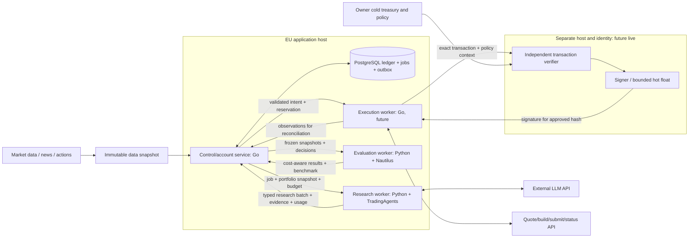

# Архитектура TradingBot: Go services и Python adapters

**Решение принято 05.10.2026.** Это целевая архитектура и порядок перехода.
Доступны Python research CLI, локальная stateless-валидация и research queue
в Go control с durable create/read, claim, heartbeat и сохранением синтетического
результата. Go fixture worker выполняет транспортный цикл задания. Python worker
запускает настоящий граф TradingAgents с локальными тестовыми моделями и получает
разрешение из общего бюджета задания перед каждым вызовом. Локальный Compose
упаковывает Go control, PostgreSQL и worker. Nautilus запускается в отдельно
закреплённом evaluation окружении. Go paper ledger ведёт виртуальные счета и
частичные и полные симулированные исполнения через локальный API.
Правила для разработчиков: [AGENTS.md](../AGENTS.md).

## Ответственность компонентов

| Компонент | Язык | Ответственность | Runtime статус |
|---|---|---|---|
| Control/account | Go | API, scheduler, jobs/leases/outbox, snapshots, ledger, reservations, deterministic risk, costs, reconciliation | `services/control/`: health, capabilities, stateless validation, PostgreSQL jobs, leases и результаты demo |
| Fixture worker | Go | Claim, heartbeat и публикация синтетического результата по выданному снимку | `services/control/cmd/research-fixture-worker`, отдельная офлайн-команда |
| Research worker | Python | TradingAgents graph, provider SDK/callbacks, portfolio arbitration, evidence, usage; выдаёт research batch | `tradingbot worker` забирает job, продлевает lease и публикует результат офлайн-графа |
| Evaluation worker | Python | Nautilus replay/backtest/paper evaluation, execution-cost models, benchmarks | `services/evaluation` с собственным lock; native probe и синтетический хронологический replay |
| Paper ledger | Go | Виртуальные деньги, позиции, резервы и журнал исполнений | `services/control/internal/ledger` с PostgreSQL, версиями состояния и историей paper fills |
| Paper workflow | Go | Снимки счёта, планирование входов и применение сохранённых решений по политике владельца | `services/control/internal/paper_workflow` связывает research с paper ledger. Команда `paper` запускает операции |
| Paper quote collector | Go | Проверяет ответы локального тестового HTTP-источника и формирует ленту котировок `0.3` | Команда `paper-quote-collect` возвращает SHA-256 для закрепления ленты владельцем |
| Venue quotes | Go | Читает публичные рыночные наблюдения через HTTP v1 | `services/venue-quotes`, [стаканы Binance Spot и Dzengi](../contracts/venue-order-book.schema.json) и [котировки Jupiter Swap v2](../contracts/venue-quote.schema.json) |
| Jupiter Adapter | Go | Котировки и цены Jupiter, остатки Solana, подготовка, отправка одобренного BUY/SELL и наблюдение статуса | `services/venue-quotes/cmd/jupiter-adapter`, [HTTP v1](../contracts/jupiter-adapter.schema.json), [ADR-004](decisions/004-jupiter-adapter.md) |
| Execution worker | Go | Allowed venue quotes/build/submit/status; без ключа и права менять policy | Будущий модуль control, затем отдельный process |
| Independent verifier/signer | Go | Decode transaction, owner limits/allowlists, approval exact hash, signing | Отдельный future live host/identity |
| Trade events | Go | Публикует события через pgqueue и Kafka | `services/trade-events/` с тестовым входом и отдельным relay для outbox paper ledger |
| Notifications | Go | Читает исполнения из Kafka, отправляет уведомления и обрабатывает аналитические команды владельца | `services/notifications/`, команды включаются при наличии URL Analytics |
| Portfolio analytics | Go | Читает события счёта и оценки из Kafka, считает NAV, P&L и доходность, предоставляет read-only API для Telegram | `services/portfolio-analytics/`, локальный paper-счёт USD. [ADR-003](decisions/003-portfolio-analytics.md) |
| PostgreSQL | SQL | Durable state/jobs/events и constraints; economic writes только через control | Локальные migrations для research snapshots/jobs/outbox, production deployment впереди |

`paper-quote-collect` и `paper-quote-pin` публикуют полностью записанные файлы
без перезаписи существующих. `paper-quote-pin` и `paper follow` используют
общую проверку привязки котировки к заданию из пакета `paper_quotes`.
Наблюдения `venue-quotes` предназначены для измерения рынка. Binance Spot и
Dzengi возвращают цену и объём уровня в единицах рынка, Jupiter — суммы
в raw units. В Binance REST depth доступен номер обновления снимка.
Оба контракта содержат время получения и тип `indicative`. Путь исполнения
paper использует собственный контракт и проверяет требования к исполнимости.

### Jupiter Adapter

Из корня репозитория команда запускается на `127.0.0.1:18084`.

```powershell
go -C services/venue-quotes run -mod=readonly ./cmd/jupiter-adapter
```

Docker-образ собирается целью `jupiter-adapter` в `services/venue-quotes/Dockerfile`.

В таблице приведены синтетические примеры запросов и ответов.

| HTTP v1 | Результат |
|---|---|
| `POST /v1/quotes` | Котировка ExactIn с маршрутом, входной суммой, ожидаемым и минимальным выходом в raw units. [Вход](../contracts/valid-venue-quote-request.json) · [Ответ](../contracts/valid-venue-quote-observation.json) |
| `GET /v1/price?mint=<mint>` | Ориентир Jupiter Price v3 в USD за токен, с block ID и временем получения. [Ответ](../contracts/valid-jupiter-price.json) |
| `GET /v1/balances` | Финализированные остатки настроенного кошелька в lamports и raw units по token accounts. `?fresh=true` принудительно читает RPC. [Ответ](../contracts/valid-jupiter-balances.json) |
| `POST /v1/swaps/prepare` | `BUY` обменивает USDC на заданный mint, `SELL` задаёт обратную пару. `in_amount` указывается в raw units входного mint, `min_out_amount` — выходного. Ответ содержит кандидат транзакции, комиссии и высоту истечения. [Вход](../contracts/valid-jupiter-swap-request.json) · [Ответ](../contracts/valid-jupiter-prepared-swap.json) |
| `POST /v1/swaps/execute` | Принять подписанный Metis v0 swap с отдельным подтверждением verifier. `202` возвращает зафиксированную в PostgreSQL попытку. [Контракт отправки](../contracts/jupiter-adapter.schema.json#/$defs/ExecutionRequest) · [Квитанция](../contracts/valid-jupiter-execution-receipt.json) |
| `GET /v1/swaps/attempts/{intent_id}` | Квитанция попытки и доступное наблюдение Solana по сохранённой подписи. |
| `GET /v1/swaps/status?signature=<signature>` | Наблюдение Solana для Metis v0 с подтверждением финализации и фактической комиссией. [Ответ](../contracts/valid-jupiter-transaction-status.json) |

`TRADINGBOT_JUPITER_LISTEN` задаёт адрес HTTP. `TRADINGBOT_JUPITER_API_KEY`
принимает ключ Jupiter. Для баланса нужны публичный адрес
`TRADINGBOT_JUPITER_WALLET` и `TRADINGBOT_SOLANA_RPC_URL` для mainnet.
Маршрут баланса возвращает `503`, пока RPC не настроен. Кэш хранит полный
снимок пять секунд. Ошибка обновления возвращается клиенту, даже если в
памяти был предыдущий снимок. Слоты в ответе показывают позицию в цепочке для
каждой группы счетов.

Подготовка требует адрес кошелька и явное
`TRADINGBOT_JUPITER_ENABLE_PREPARE=true`. Использование Jupiter для новых
запросов зависит от подтверждения допуска в [плане](planning/plan.md#16-xstocks-vs-ondo-vs-broker).
Кандидаты Metis v0 передаются на независимую проверку и подпись.
Локальные тесты используют имитацию Jupiter и RPC, а журнал проверяется
на PostgreSQL.

Маршруты отправки и квитанций выключены по умолчанию. Для разрешённого live
контура применяется [миграция журнала попыток](../services/venue-quotes/internal/jupiter_execution/001_attempts.sql).
Роль адаптера использует SELECT, INSERT и UPDATE. При включении
`TRADINGBOT_JUPITER_ENABLE_EXECUTE=true` необходимы Jupiter API key, mainnet RPC,
loopback HTTP, `TRADINGBOT_JUPITER_SUBMISSION_DATABASE_URL`,
`TRADINGBOT_JUPITER_APPROVAL_PUBLIC_KEY` (Ed25519, стандартный Base64),
`TRADINGBOT_JUPITER_POLICY_SHA256` и отдельный
`TRADINGBOT_JUPITER_EXECUTOR_TOKEN` для `Authorization: Bearer`.
Формат подписи одобрения описан в [ADR-004](decisions/004-jupiter-adapter.md).
Изолированный verifier/signer и live-резервы находятся за границей адаптера.

#### Сквозной офлайн-прогон Jupiter

Для прогона нужен локальный тестовый PostgreSQL, где роль может создать и
удалить отдельную схему. Укажите его в `TRADINGBOT_TEST_DATABASE_URL`
и запустите команду из корня репозитория.

```powershell
go -C services/venue-quotes test -mod=readonly -count=1 -v ./internal/jupiter_rehearsal
```

Прогон запускает Control на loopback, использует обычные ручки адаптера
и удаляет созданную схему по завершении. Тестовый транспорт отвечает на
запросы Jupiter и Solana внутри процесса. Подписание использует временный
кошелёк и отдельный ключ одобрения. Подписывается только заранее определённая
тестовая Memo v0. BUY проверяет таймаут, удержание резерва, восстановление
попытки и `paper reconcile`. SELL проверяет резерв токенов до финализации.
В обоих случаях exact raw amounts берутся из изменения тестовых остатков
после подтверждённого слота. USDC учитывается по синтетическому паритету
с USD, сетевые комиссии наблюдаются отдельно в lamports.
[Результаты прогона](verification.md#сквозной-офлайн-прогон-jupiter)

#### Jupiter в периодическом paper-цикле

`paper dispatch --jupiter-fixture-url` подключает локальный тестовый
расчёт Jupiter через числовой loopback-адрес. Закреплённая котировка с
`execution: "jupiter_fixture"` выбирает этот режим и связывается с заявкой
при резервировании. Запрос на расчёт привязан к исследованию, ордеру,
котировке и точным суммам. Квитанция подтверждает хеш исходного запроса.
При `pending` диспетчер сохраняет резерв и продолжает проверять ту же
попытку. При финализации ledger учитывает подтверждённый объём и сумму
в пределах исходного лимита. Обычная симуляция с этим видом котировки
отклоняется. [Контракт расчёта](../contracts/paper-jupiter-fixture.schema.json)

Сквозной тест запускает штатные команды планирования и диспетчеризации,
Control и worker с заданными тестовыми решениями через обычный протокол
аренды и публикации результатов. Он использует локальный тестовый PostgreSQL
из `TRADINGBOT_TEST_DATABASE_URL` и дочерний тестовый сервер Jupiter.

```powershell
go -C services/control test -mod=readonly -count=1 -v -run '^TestScheduledPaperJupiterRehearsal$' ./cmd/paper
```

### Paper

В протоколе forward paper `paper_forward_source` фиксирует счёт, капитал,
календарь UTC, контрольные даты, источник и возраст цен, эталон и порог просадки.
После контрольной даты `forward-paper-report` повторно сверяет этот протокол
и артефакты стратегии. Выгрузки NAV, эталона и расходов получают независимые
хеши. Отчёт публикует хеш исходной регистрации и хеш протокола, производного
для конкретного периода. Эти проверки устанавливают целостность файлов.
Время регистрации и происхождение фактических наблюдений требуют отдельных
подтверждений.

Опциональный режим `require_prior_receipt` связывает контрольные даты.
Каждая квитанция хранит хеш использованного файла и хеш дневных записей
до своей даты. Следующий отчёт требует отдельно сохранённый хеш предыдущей
квитанции и проверяет старые строки. `paper-nav --verify-report` отдельно
воспроизводит NAV по закреплённым ценам и сохранённым событиям PostgreSQL.

Worker сохраняет завершение вызова отдельно от результата задания.
Каждая запись связана с уже выданным разрешением, ID попытки и сроком
аренды. Claim, heartbeat, выдача разрешений и завершение используют одно
состояние задания под блокировкой строки PostgreSQL. Историческая запись
расхода по-прежнему связана с попыткой, получившей разрешение.
PostgreSQL экспортирует все разрешения задания одним снимком
через `research-usage-export`. Отсутствующий callback виден в выгрузке и
остаётся неизвестным для оценки расходов. Точный повтор возвращает
исходную отметку записи.

Go — основной язык собственного backend. Python сохраняем для библиотек, которые
уже предоставляют graph, structured inference и evaluation engine. Обычные внешние
HTTP API доступны из Go: подключение к удалённому сервису само по себе не причина
создавать Python компонент. Языковая граница следует dependency и полномочиям.
Ускорение provider inference этой архитектурой не измерено; производительность
нашего кода проверяем профилированием и latency/cost метриками.

Сначала два service runtime: Go control и Python research. Evaluation запускается
offline по отдельному профилю и получает независимое окружение при упаковке
Nautilus. Executor становится отдельным service перед выделением его production
credentials; signer всегда отдельная signing boundary. Аналитики внутри
TradingAgents остаются частью одного upstream graph.

## Целевой поток



Control выбирает разрешённый universe и immutable state. AI определяет торговое
решение; Go проверяет его допустимость. Go kernel не подменяет стратегию набором
BUY/SELL сигналов. Python batch не является командой подписи и не переписывает
авторитетный portfolio state. Research/paper stages не подключают signer.

### Исследование лонга и шорта

`tradingbot perp-research` рассматривает один новый вход в линейный бессрочный
контракт с изолированной маржой на пустом виртуальном счёте. Контракт рынка
и базовая акция имеют разные идентификаторы. Входной
[снимок](../contracts/perp-research-study.schema.json) содержит доступное
обеспечение, политику и наблюдения рынков. Для каждого размера и стороны
снимок задаёт комиссию и потери в спреде и проскальзывании за полный круг,
ожидаемые платежи funding и стрессовую оценку funding на один горизонт.
Положительный funding в полях затрат означает расход для указанной стороны.

Go-команда `perp-screen` проверяет доступность данных на момент среза, разницу
между mark и index, общий размер, разрешённые варианты плеча, обеспечение
и лимит потерь в стрессовом сценарии. Из результата
[screen](../contracts/perp-research-screen.schema.json) Python автоматически
берёт список базовых акций для TradingAgents. Отдельный структурированный
вызов оценивает сценарии LONG и SHORT и выбирает один допустимый рынок,
размер и плечо либо остаётся вне рынка. Для входа обязательны обоснование,
условия отмены тезиса и время пересмотра. Прогноз после оценочных затрат
проверяется по минимальному порогу политики.

Иллюстративная формула маржи `notional / leverage` и запас после движения цены
используются в исследовательском сценарии. Расчёт фактической ликвидации,
допуск к площадке, перевод размера в лоты, записи счёта и ордера относятся
к следующим этапам. Снимок поступает из локального файла, а CLI запускается
по запросу. Реальный режим использует бюджеты вызовов TradingAgents и его
отчёты на выбранную дату. Внутридневная доступность этих отчётов отдельно
не подтверждена.

Эти команды запускают локальную проверку из корня на тестовом снимке
с фиксированным ответом модели.

```powershell
$perpScreenBin = Join-Path $env:TEMP 'tradingbot-perp-screen.exe'
go -C services/control build -mod=readonly -o $perpScreenBin ./cmd/perp-screen
uv --directory services/research run --frozen tradingbot perp-research `
  --study ../../contracts/valid-perp-research-study.json `
  --screen-binary $perpScreenBin `
  --fixture-forecast examples/perp-research-forecast.json
```

NautilusTrader 1.231.0 проверен в отдельном evaluation-тесте через Rust bindings.
Движок открыл синтетические лонг и шорт, списал 2 USD с лонга и начислил 4 USD
шорту на границе funding. Текущий Cython equity replay и этот тест используют
разные интерфейсы движка. Для деривативного replay нужен отдельный вход с
архивом mark, funding и правил конкретного рынка.

### Сравнение маршрутов на одном тезисе

`tradingbot equity-theses` формирует прогноз изменения цены базовой акции на
общем горизонте. Команда получает список бумаг из проверенного Go-снимка,
использует закреплённый клиент модели TradingAgents и локальный архив с
проверенной идентичностью бумаги. Она выдаёт горизонт пересмотра, условия
отмены тезиса и хеши использованного контекста. Контракт
[тезисов](../contracts/equity-route-theses.schema.json) связан с SHA-256
точных байтов [снимка](../contracts/equity-route-study.schema.json).

Go-команда `equity-route` сверяет время котировок и состояние счёта.
На каждом общем размере экспозиции она рассматривает спотовый вход и
perp long для положительного тезиса, perp short для отрицательного тезиса
при отсутствии позиции, сокращение или закрытие удерживаемого спота
и пропуск сделки. Первый срез разрешает одну рекомендацию на весь снимок.
Счёт с открытым perp или незавершёнными заявками требует отдельной сверки.
Для каждой бумаги нужен подтверждённый горизонт без корпоративных событий.

Экономика считается в долларах точной арифметикой. Расчёт вычитает
издержки горизонта и поправку на неопределённость прогноза. Затем из
консервативного net P&L вычитается заданный политикой вес стресс-убытка.
Ожидаемый доход от funding исключён из сравнения. Оценка funding в стрессовом
сценарии должна покрывать смену знака ставки. Для perp long требуются свежая
внешняя сессия на весь горизонт и преимущество после затрат над спотом при
том же размере либо над пропуском сделки. Для лонга с плечом нужна также
свежая котировка сопоставимого спота. Go проверяет целые значения от 1×
до меньшего из `policy.max_leverage` и `venue_max_leverage` для данного
размера. Он допускает большее плечо только если на всех меньших уровнях
не хватает свободного залога для той же экспозиции. В старых снимках
с `allow_leverage: true` без `max_leverage` сохраняется лимит 2×.
Политика с `allow_leverage: false` ограничивает входы уровнем 1×.

Допуск плеча выше 1× требует выполнения лимита потерь, лимита капитала в изолированной
позиции и запаса над поддерживающей маржой после стресса. Выигрыш и по net
USD, и по USD с поправкой на риск должен превышать порог политики относительно
лучшего допустимого кандидата без плеча по всему снимку. Высвобождённый залог
не записывается как прибыль. Результат показывает оба сравнения, расчёты и
причины отказа по отдельным вариантам. Маржа здесь считается консервативным
сценарием, точный порядок ликвидации зависит от конкретной площадки.

Тестовый снимок и заранее заданный прогноз можно прогнать из корня репозитория.

```powershell
$equityRouteBin = Join-Path $env:TEMP 'tradingbot-equity-route.exe'
go -C services/control build -mod=readonly -o $equityRouteBin ./cmd/equity-route
& $equityRouteBin --study contracts/valid-equity-route-study.json `
  --theses contracts/valid-equity-route-theses.json
```

`go -C services/venue-quotes run ./cmd/equity-perp-capture --symbol NVDA`
собирает публичные `metaAndAssetCtxs` и `l2Book` для `xyz:NVDA`.
Команда возвращает параметры контракта, mark, oracle и наблюдаемый funding,
уровни стакана и точные байты обоих ответов в Base64 с SHA-256. Повторяемый
флаг `--quantity` оценивает покупку и продажу по всей нужной глубине.
Оценка отражает спред и проскальзывание на текущем стакане до комиссий и
funding. При недостатке глубины результат указывает отказ по этому размеру.

`equity-study` собирает вход для `equity-route` из архивных стаканов спота
и trade[XYZ]. [Контракт входа](../contracts/equity-study-input.schema.json)
принимает привязку инструмента к базовой акции, курс валюты котировки,
лот, независимую цену акции, комиссии и стресс-параметры. Он сверяет
актуальность и разницу во времени срезов, восстанавливает perp из
оригинальных ответов с SHA-256 и округляет размер вниз к общему шагу
экспозиции в акциях. По каждому размеру требуется полная глубина
на покупку и продажу. Хеш входного файла и хеши отдельных наблюдений
включаются в итоговый снимок.

К двусторонней стоимости стакана добавляются taker-комиссии и фиксированные
издержки каждого плеча сделки. Для funding применяется захваченная ставка
к oracle-цене на каждый час горизонта. Это сценарий постоянной ставки.
Стресс применяет неблагоприятный знак и учитывает рост номинала и введённый
порог ставки. Для маржи используется уровень при неблагоприятном номинале
и его полная ставка без скидки за нижние уровни. FX, экономический базис,
комиссии, внешняя сессия и стресс-параметры задаются входным файлом.
[Funding](https://hyperliquid.gitbook.io/hyperliquid-docs/trading/funding) ·
[Уровни маржи](https://hyperliquid.gitbook.io/hyperliquid-docs/trading/margin-tiers)

Синтетический сценарий запускается следующими командами из корня репозитория.

```powershell
$studyPath = Join-Path $env:TEMP "tradingbot-equity-study-$PID.json"
$thesesPath = Join-Path $env:TEMP "tradingbot-equity-theses-$PID.json"
$study = go -C services/venue-quotes run -mod=readonly ./cmd/equity-study `
  --input ../../contracts/valid-equity-study-input.json
if ($LASTEXITCODE -ne 0) { throw "equity-study failed" }
$study | Set-Content -LiteralPath $studyPath -Encoding utf8
$batch = Get-Content -Raw contracts/valid-equity-route-theses.json | ConvertFrom-Json
$batch.study_sha256 = (Get-FileHash -LiteralPath $studyPath -Algorithm SHA256).Hash.ToLowerInvariant()
$batch | ConvertTo-Json -Depth 10 | Set-Content -LiteralPath $thesesPath -Encoding utf8
go -C services/control run -mod=readonly ./cmd/equity-route --study $studyPath --theses $thesesPath
```

Для рыночного прогона нужен архив с актуальными наблюдениями и правилами
площадок. Планировщик их сбора и forward paper остаются следующими этапами.

Research сохраняет решения без блокировки реальных средств. Paper ledger и
его reservations отделены от live account. Резервирование реальных cash/tokens
появляется только в разрешённом live протоколе и не выводится из research DTO.

В локальном режиме `paper snapshot` выпускает research-портфель из
версии бумажного счёта. ID снимка включает точные значения портфеля, policy
и доступные на момент снимка цены. Подбор котировки, исполнение и проверка
сохранённой заявки используют один проверенный контекст завершённого research.
Он связывает задание, evidence, политику, инструмент и время результата.
Ledger повторно проверяет версию счёта под блокировкой при резервировании.
[Контракт команды](../contracts/paper-apply.schema.json).

`schedule-review` пишет контекст применения и задание одной транзакцией
в PostgreSQL. `paper dispatch` читает завершённые записи своего
счёта и использует тот же жизненный цикл, что `paper follow`.
Проверенная котировка фиксируется атомарно с резервом. При восстановлении
используются эти сохранённые байты, даже если владелец сменил текущую политику.
Диспетчер подтверждает завершение после сохранения квитанции ledger.
В профиле `paper` контейнер research видит только архив и HTTP Control.
После таймаута локальное наблюдение с хешем разрешает остаток исходной
виртуальной заявки. PostgreSQL проверяет идентичность котировки и сохраняет
исход наблюдения в событиях ledger. Запись и восстановление истории outbox
используют один расчёт изменений денег, количества и оставшегося резерва.

Python-циклы входа и пересмотра используют общий порядок подготовки,
сохранения и отправки заявки. Сначала читается локальный журнал, затем
проверяется срок нового окна. Повтор после сбоя отправляет исходные байты.
Go research scheduler при загрузке фиксирует байты задания, сроки и данные
календарного подтверждения. Отчёт покрытия читает тот же план.

Контрфактуальный отчёт читает сохранённый отказ симулятора и независимо
зафиксированные наблюдения входа и выхода. Метка указывает ID отмены
и горизонт. Чтение происходит в read-only режиме. История исполнений
и суммы учёта берутся из ledger.

`research-replay-export` читает исходные запросы и результаты из одного
снимка PostgreSQL. Python evaluation проверяет их хеши и сверяет время
с синтетической лентой перед передачей заявок в Nautilus. Экспорт и лента
хранятся отдельно от производного replay input для воспроизведения отчёта.
Лента `0.2` для решений с устойчивым ID фиксирует реестр владельца и
соответствие каждой бумаги отдельному ключу Nautilus. Котировки, сплиты,
дивиденды и календарь используют этот ключ на всём интервале. Прогон всегда
сверяет снимки портфеля с состоянием Nautilus. Хеш проекции research можно
независимо воспроизвести командой `verify-identity-export`.
Дневной отчёт `replay-evidence` по устойчивым ID заново строит заявки из
исходного экспорта, ленты и реестра. Протокол закрепляет хеши этих входов,
предел давности котировок и `security_id` отдельных эталонов. Для стратегии
и эталонов применяются одни и те же отсечки UTC и условия синтетической ленты.
Дневной NAV стратегии и нативных бенчмарков снимается в одном проходе Nautilus
на виртуальный счёт. Каждая отметка использует данные до своего среза.
В строгом режиме Nautilus восстанавливает счёт от выделенного cash к
каждому снимку и сверяет позиции и балансы. Прогон прерывается, если
заявка использует снимок, устаревший до исполнения. Это проверка
предоставленной синтетической выборки.
Происхождение и полнота рыночных данных проверяются отдельно.

`walk-forward` на каждом срезе восстанавливает портфель из предшествующих
виртуальных исполнений. Evaluation передаёт его отдельному локальному
процессу `historical-step` через JSON. Research проверяет хеш архива,
фильтрует записи по локальному времени получения и выполняет закреплённый
офлайн-граф с лимитом вызовов. Момент завершения берётся из синтетического
плана. В отчёте он не является квитанцией PostgreSQL или измеренной
задержкой провайдера.
План и лента `0.2` добавляют пин реестра и устойчивые ID. Evaluation
восстанавливает точный инструмент по ключу Nautilus, а отдельный процесс
research независимо сверяет архив и реестр. Каждый шаг проверяет непрерывность
снимков. Финальная оценка требует допущенного инструмента и видимой котировки.

Для дневного отчёта протокол `walk_forward_source` фиксирует входной план
и ленту. Прогон формирует шаги анализа из этих входов, а NAV повторно
рассчитывается нативным движком к концу каждого дня. Сводка проверяет
связь отчёта с протоколом и хранит хеш шагов. Проверка происхождения
выполняется повторным прогоном на исходных файлах. Бумажный NAV допускает
отдельный хешированный ряд синтетического индекса полной доходности.
Для сравнения вариантов `ablation-evidence` закрепляет общий реестр,
исходные файлы, даты и совокупный бюджет. Хеш реестра сохраняется в
квитанции каждого варианта вместе с хешами шагов и конфигураций.

`schedule-entry` использует выданный Control снимок и хеш локального
результата отбора. Допущенный вход использует то же атомарное сохранение
задания и контекста применения, что пересмотр позиции. Фиксация forward
эксперимента связывает файлы конфигурации с составом стратегий и протоколом
оценки. [Команды запуска](../README.md#виртуальный-paper-счёт).

Локальный процесс `entry_cycles` обрабатывает хешированный план и сохраняет
входы Go в журнале до отправки. Профиль `paper-entry` монтирует архив для
чтения и сохраняет журнал в отдельном томе. Очередь обслуживает research
worker через Control. Профиль `paper-quote` читает хешированную синтетическую
ленту счёта и сохраняет закреплённые котировки для завершённых заданий.
Диспетчер читает ту же директорию. После смены политики продолжение
зарезервированного ордера сверяет исходное применение и закреплённую
котировку с ledger. Для нового резерва требуется действующая политика.

Профиль `research-provider` берёт только подготовленные задания `0.3` по
пину реестра и режиму `prepared_provider`. Подготовленный архив
`local_archive` проходит ту же проекцию устойчивых ID. Перед одним вызовом
портфельной модели worker получает разрешение Control, после ответа отправляет
квитанцию с моделью и usage. В одной транзакции Control сопоставляет квитанцию
и результат `0.4` с текущей арендой, пинами и job budget. Пересмотр
открытой позиции наследует режим принятого входа. Диспетчер использует
обычный paper risk и котировку с наблюдением после сохранения результата.
[Команды и исходные данные](../README.md#ai-по-расписанию-с-виртуальным-исполнением)

Профиль `paper-notifications` читает из того же ledger подтверждённые
fills через outbox, переносит в выделенный Kafka-топик
`tradingbot.trade.filled.paper.v1` и доставляет paper-сообщения через
отдельную группу потребителя. Фиксация смещения Kafka следует за
подтверждением Telegram. [Гарантии доставки](decisions/002-trade-notifications.md)

Вход с устойчивым ID использует расписание `0.2`. Go проверяет активный
реестр владельца и сопоставляет `security_id` с точным инструментом
в политике и снимке. PostgreSQL принимает задание и запись диспетчера
одновременно. Запись фиксирует хеш конфигурации отбора, хеш проекции,
архив котировок, упорядоченные привязки и срок их действия. Перед новым
резервом диспетчер сверяет результат исследования, текущие пины
и точные байты firm-котировки
из ленты `0.3`. Срок резерва ограничен первым истекающим входом. После
сбоя диспетчер продолжает сохранённую заявку с её исходной котировкой.

Планировщик пересмотра берёт факт открытия и актуальный снимок из ledger.
При наступившем сроке или архивном катализаторе он создаёт research job с
устойчивым ID триггера. Пересмотр `0.2` проверяет исходное применение,
котировку и квитанцию из PostgreSQL. Независимо подготовленный снимок,
его проекция и текущий реестр владельца фиксируются в задании. Если реестр
обновился, исходный `security_id` и точный инструмент должны по-прежнему
соответствовать открытой позиции. Катализатор бумаги должен ссылаться на
тот же ID у разрешённого провайдера или на сопоставленный SEC CIK.
В исходах `paper-memory` для следующего research
остаются только сверенные FIFO-исполнения, записанные к cutoff. Источник и
комиссии передаются вместе с исходом. [Порядок запуска](../README.md#виртуальный-paper-счёт).

В профиле `paper-review-cycles` локальный оркестратор получает снимок на
каждое окно хешированного плана и фиксирует собранный запрос в отдельном
томе журнала. Go отслеживает принятый триггер в PostgreSQL. Повтор после
сбоя использует сохранённые байты, а более поздний срез уже обработанного
триггера получает исходный job ID. Записи плана ссылаются на локальные цены
и архивные события, доступные к моменту снимка.

Отчёт об исходе тезиса `0.2` сверяет привязку каждой отнесённой FIFO-продажи
с исходной покупкой. Для оценки открытого остатка выбирается подходящее
firm-наблюдение на полном объёме из закреплённой ленты `0.3` исходного счёта.
Закреплённый реестр ленты должен допускать тот же инструмент на момент оценки.
Хеши открытия, исполнений, реестра и выбранной котировки позволяют
воспроизвести расчёт. При отсутствующем наблюдении оценка остатка неизвестна.

Журнал уроков хранит точный исход виртуального SELL и смену статуса отдельными
событиями. Экспорт `paper-memory --durable-lessons` читает FIFO и активную
ревизию из одного снимка PostgreSQL. Python сверяет источник и момент
доступности. Исторический `factual_reflection` использует сохранённый вывод
на срезе экспорта. Research `0.2` включает такие выводы только для той же
бумаги и точного инструмента. Для выводов используется активная durable
ревизия к моменту решения.

## Межсервисный contract

Начинаем с HTTP/JSON и явного protocol version. Длительный LLM/backtest workflow
выполняется как job: bounded request выдаёт durable job ID, worker использует
lease/attempt/heartbeat, результат публикуется отдельно. Открытый HTTP-запрос
на всё время анализа не является механизмом очереди.

Job envelope `0.1` для create/read содержит immutable research portfolio,
ссылку и хеш data manifest, requested symbols, policy version и call budget.
Control возвращает durable ACK после commit snapshot, job и creation outbox.
PostgreSQL выдаёт и продлевает один действующий lease на job по своему времени.
Попытку идентифицируют worker ID, claim ID, номер и уникальный token.
Повтор того же claim в пределах lease возвращает уже выданную попытку.
Completion принимает метаданные `synthetic_fixture` в контракте `0.1` и
`tradingagents_offline` в `0.2`. В `0.2` Go связывает результат с попыткой,
исходным манифестом, политикой и лимитом вызовов из сохранённой job. Версии,
SHA upstream, хеш конфигурации и учёт вызовов публикует Python worker.
Go fixture worker публикует без обращения к моделям, используя только выданный
snapshot и universe. При потере ответа он повторяет тот же claim ID или payload
completion. Control сравнивает batch с сохранённым snapshot и universe, пересчитывает
evidence hashes из текста и проверяет lease перед записью. Результат, статус
и outbox commit атомарно. Для тестовых моделей USD billing неизвестен.
Для локального PIT-архива worker сверяет хеш и доступность каждой записи
и её локальное получение к моменту снимка. Архивная диагностика позволяет
отдельно воспроизвести срез по времени публикации источника. Research DTO
содержит `run_id`, `portfolio_snapshot_id`, `as_of`, `created_at`, `expires_at`,
`evidence_hashes`, `intents` и `schema_version="0.1"`.

Job envelope `0.2` сохраняет ссылку на реестр владельца и упорядоченную
привязку запрошенных тикеров к `security_id`. Control принимает новый
контракт при включённом пине SHA-256. Транзакция аренды выбирает задания
конкретного реестра и сохраняет пин вместе с ID попытки. Для старых
заданий используется пустой пин. Архивный worker сверяет точную ссылку
и хеш отдельно от задания, проверяет доступный листинг и передаёт
в TradingAgents срез выбранной бумаги. Результат `0.3` содержит исходные
привязки и SHA-256 проекции. Control сверяет привязки с исходным заданием.
Выгрузка хранит точные байты запроса и результата для воспроизведения среза.

Для каждого модельного вызова Go проверяет действующий lease и резервирует один
слот из `max_llm_calls` в PostgreSQL. Новый вызов допускается после подтверждения
записи. `call_id` делает повтор запроса идемпотентным. Потерянная квитанция,
прерывание модели и истечение lease сохраняют расход слота. Новая попытка
вычитает все разрешения задания. Go проверяет число разрешений попытки и число
вызовов в результате `0.2` под той же блокировкой задания. Миграция считает
неучтённый расход прежних активных попыток неизвестным и блокирует новые
разрешения по таким заданиям. Ранее записанные результаты доступны и допускают
идемпотентное чтение через прежний протокол.

Добровольно активируемый суточный лимит относится ко всей research
очереди. Выдача разрешения и активация используют одну блокировку в
PostgreSQL. Выданные до активации разрешения входят в расход тех же суток
UTC. После первой даты из политики сутки без лимита блокируют новые
разрешения, а запрос с прежним ID возвращает исходную квитанцию.

| Инвариант границы | Требование |
|---|---|
| Money/quantity | Decimal strings, exact arithmetic, explicit scale/rounding; raw token units integer strings |
| Schema | Strict fields/types/version; serialized schema и общие producer/consumer fixtures |
| Provenance | Snapshot/version/hash, evidence references, config/upstream/artifact versions |
| Freshness | UTC timestamps, expiry, stale portfolio refusal, quote TTL separately |
| Idempotency | Job/run/result IDs + attempt/lease + payload hash; same ID/different hash — conflict |
| Authority | Result endpoint не принимает новые balances, owner policy, credentials или signing instructions |
| Availability | Durable ACK после transaction commit; UNKNOWN execution удерживает reservation |

Research DTO описан [общими JSON Schema и fixtures](../contracts/).
Python сериализует amounts десятичными строками. Go проверяет схему,
freshness и согласованность распределения с переданным portfolio и universe.
И диагностика, и локальное создание job получают research portfolio от
вызывающей стороны. Сохранённая запись фиксирует этот ввод. Control проверяет
сохранённые хеши перед выдачей и проверяет attempt и snapshot при записи результата.
Доступность содержимого data manifest проверяется при интеграции с архивом.
Право на paper/live execution задаётся отдельными протоколами.

## Данные и полномочия

PostgreSQL хранит авторитетное состояние внутреннего учёта. Control владеет
ledger, reservations и account serialization. Фактические остатки Solana-кошелька
наблюдаются отдельно через RPC. Job creation и outbox фиксируются атомарно;
worker не держит SQL transaction во время provider calls. Research работает
через control contract без прямых write credentials к balances/reservations.
Evaluation может иметь собственную область хранения результатов, с ограниченной
ролью; она не меняет реальный ledger. Research jobs используют PostgreSQL.
Kafka используется для событий об исполненных сделках по [ADR-002](decisions/002-trade-notifications.md).
`trade-events` владеет outbox и соединением с PostgreSQL. `notifications`
имеет доступ к Kafka и Telegram. Сервисы собираются из отдельных Go-модулей,
обмениваются событиями по версионированному JSON-контракту и разворачиваются
через [Compose](../deploy/notifications/compose.yaml).

Большие evidence/data objects хранятся как immutable files/object archive;
в SQL — hashes, timestamps, versions и ссылки. Outputs и memory lessons не
дают исполнительных полномочий. Расходы и outcomes сохраняются воспроизводимо.
Live reconciliation подтверждает реальные fills/finality по независимым
наблюдениям; timeout сам по себе не освобождает cash и не разрешает resend.

Deployment: monorepo, независимые binaries/images, приватная service network,
раздельные credentials/limits и Docker Compose на первом application host.
Signer имеет отдельный host/identity/policy, вне обычного Compose application
trust boundary. Kubernetes/service mesh не требуются текущим scale и SLA.
Эти ограничения будут проверяться acceptance tests, сейчас это проектное решение.

## Независимые обновления

TradingAgents — библиотека внутри нашего research service. Репозиторий остаётся
clean checkout, адаптер находится в `services/research/tradingbot/adapters/tradingagents.py`.
Service artifact фиксирует exact source SHA, Python lock hash и contract version.
Go consumer знает наш protocol; имена upstream Python functions для него закрыты.

Обновление проходит так:

1. В отдельном build окружении получить candidate release по tag и SHA.
2. Обновить только research зависимости; провести upstream adapter, producer
   и consumer compatibility tests против текущего Go artifact.
3. Выпустить immutable research image/artifact с manifest/digest. Readiness
   подтверждает конфигурацию, upstream capability и поддерживаемый protocol.
4. Остановить получение новых jobs старым worker; drain активные attempts или
   дождаться корректного lease expiry. Передать jobs новому worker.
5. Контролировать failures/usage/latency; при regression вернуть прежний artifact,
   сохранив ledger, job IDs, reservations и audit history.

Research и evaluation имеют отдельные `pyproject.toml`, `uv.lock` и Dockerfile.
В research остаётся дополнительная зависимость для локальной проверки Nautilus.
Go/control и execution/signer сохраняют собственные версии при обновлении TA,
если наш protocol не изменился. Breaking protocol change требует versioned
migration и совместного rollout, без ручного merge с чужими исходниками.

Рабочий updater применяется к остановленному dev/build checkout. В запущенном
сервисе не выполняются `git pull`, `uv sync` или замена `.venv`.
[Текущая процедура](upstream-updates.md) и
[план перехода](planning/service-migration.md) задают разные этапы.
