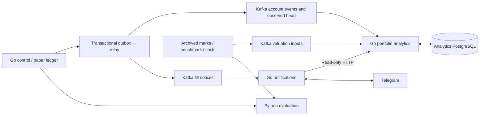

# ADR-003 — Аналитика портфеля и отчёты в Telegram

Реализован первый срез для одного paper-счёта в USD.
[Запуск и восстановление](../runbooks/paper.md#аналитика-портфеля-в-telegram).

## Задача

Владелец открывает Telegram и видит стоимость портфеля (NAV), доступные деньги,
позиции и результат за период. По отчёту о доходности он сравнивает результат
с рынком и видит, сколько ушло на исполнение и работу стратегии.
Структура первого экрана опирается на сводку PortfolioAnalyst, а история
доходности и просадки — на принятые в Nautilus представления.
[IBKR PortfolioAnalyst](https://www.interactivebrokers.com/campus/trading-lessons/portfolioanalyst-reports/), [графики NautilusTrader](https://nautilustrader.io/docs/latest/concepts/visualization/).

## Отчёты владельца

| Команда | Содержание |
|---|---|
| `/portfolio` | Сводка счёта. NAV, свободный, зарезервированный и общий кэш, стоимость акций, крупнейшие позиции и их доли в NAV, текущий нереализованный P&L и денежный P&L за последние 30 дней при наличии истории. |
| `/positions` | Все открытые позиции. Инструмент, количество, в том числе зарезервированное, оставшаяся FIFO-себестоимость, цена оценки и её время, рыночная стоимость, доля, нереализованный P&L. |
| `/performance [7d\|30d\|all]` | Последний закрытый день UTC и фактические границы окна. Денежный P&L, реализованный P&L за период, изменение нереализованного P&L, TWR, benchmark, разница в п.п. и максимальная просадка, когда есть пригодный ряд. По умолчанию `30d`. |

Каждый ответ показывает `PAPER`, валюту, время состояния счёта и доступность
оценки. При короткой истории отчёт показывает фактическое окно, например
«с запуска, 12 дней». Сводка даёт кнопки «Позиции» и «Доходность».
Дальше добавляем график NAV в валюте, сравнение стратегии и benchmark от одной
базовой точки и график просадки. Для списка позиций достаточно
сортировки по стоимости. Позже добавить `/trades` с фильтром по инструменту
и объединением partial fills по заявке, а также `/costs` с комиссиями,
сетью, LLM, данными и инфраструктурой. Для диагностики стратегии полезны
результат и вклад каждого инструмента, концентрация, оборот, доля времени
в кэше и качество исполнения по заявкам.

## Компоненты и данные

- `services/portfolio-analytics/` — независимый Go-модуль, Kafka consumer
  со своей group, собственные таблицы PostgreSQL и внутренний read-only API.
  Для первого развёртывания достаточно отдельных базы или схемы и DB-роли на
  имеющемся PostgreSQL. Сервис хранит принятые события, состояние портфеля,
  FIFO-лоты и наблюдения цен. Дневной ряд рассчитывается по согласованному
  снимку этих данных при запросе отчёта. Права менять
  счёт, инициировать сделки и токен Telegram остаются вне сервиса.
- Control записывает события потока `tradingbot.portfolio.account.paper.v1`
  в outbox в транзакции ledger. После commit relay публикует их с ключом
  paper account ID. Контракт содержит версию схемы, `account_id`, `event_id`,
  `account_version`, тип события, время наблюдения (если применимо) и записи.
  Алгоритм хеширования содержимого фиксируется в контракте. Первая версия
  переносит создание счёта с финансированием,
  резерв, partial fill, полный fill, `UNKNOWN` и отмену. Control передаёт
  точные cash и reserved cash после изменения, обновлённые количества и
  резервы инструментов. Для fill нужны сторона, booked quantity, gross,
  fee, время и идентификаторы заявки, решения и котировки. Источник точных
  резервов — Control, включая округление и сохранение резерва при `UNKNOWN`.
- Текущие paper fill-уведомления передают факты исполнения по ключу fill.
  Аналитика подписывается на полный поток счёта и считает каждое исполнение
  из него один раз. Тестовый `exchange_fixture` обслуживает контур уведомлений.
  [ADR-002](002-trade-notifications.md).
- Для оценки нужен отдельный поток наблюдений, первая версия — импорт
  архивных цен. Цена относится к реально удерживаемому `instrument_id` и
  версии реестра, с единицей, валютой, источником, `observed_at` и
  `available_at` по первому документированному получению. Время загрузки
  исторического архива фиксируется отдельно. Бенчмарк и затраты можно добавить
  как типы входов с собственными ID, временем и источниками.
  Пополнения после создания, выводы, дивиденды, corporate actions и FX
  требуют поддержки авторитетных входов до включения соответствующих метрик.

### Порядок, восстановление и свежесть

1. Analytics проверяет схему и кладёт запись в PostgreSQL с уникальностью
   по `(account_id, event_id)` и `(account_id, account_version)`. Там же
   применяет непрерывную последовательность к проекции. Kafka offset
   фиксируется после успешной транзакции. Дубль с тем же содержимым безопасен,
   конфликт ID/версии или неизвестный формат останавливает consumer и оставляет
   позицию для диагностики и повтора. Версия `V+2` до `V+1` сохраняется в ожидании,
   чтобы consumer мог дочитать партицию. Отчёт до закрытия разрыва остаётся
   на `V`, со статусом отставания. Очередность записей определяет версия
   ledger независимо от времени исполнения и порядка доставки.
   [Apache Kafka, гарантии доставки](https://kafka.apache.org/43/design/design/#message-delivery-semantics).
2. Control заполняет outbox нормализованной историей существующего счёта.
   Legacy full fill с пропущенным raw quantity использует booked quantity
   из таблицы исполнений. При исчерпании Kafka retention relay может повторно
   опубликовать версии от начала счёта до зафиксированной головы. Перекрытие
   дедуплицируется. Архив рыночных входов импортируется с прежними ID.
   [Чтение ledger](../../services/control/internal/ledger/read_snapshot.go),
   [обработка старых fill](../../services/control/internal/paper_memory/outcomes.go).
3. Relay регулярно читает голову ledger и публикует её в
   `tradingbot.portfolio.account-head.paper.v1`. Analytics сверяет эту версию
   и время наблюдения с применённой последовательностью событий. Свежесть
   счёта и цен проверяется независимо. При разрыве или отставании ответ
   показывает последнюю известную версию счёта и её время. Ошибки обработки
   Kafka журналируются с topic, partition и offset.

### Граница Telegram

`services/notifications/` сохраняет отправку fill-уведомлений и обрабатывает
команды через одного `getUpdates` poller для токена. Проверяются тип личного
чата, настроенные chat ID и user ID владельца. Уведомления и команды используют
тот же транспорт, расчёт всегда запрашивается у Analytics по внутреннему HTTP.
Счёт определяется настройками сервисов владельца. API отдаёт согласованный
снимок с ID отчёта, версией счёта, `as_of`, временем сверки, границами периода,
валютой, временами оценки и статусом полноты. Кнопки отчёта привязаны к его ID.
Списки позиций и исполнений разбиваются на страницы. При недоступности API
бот сообщает, что отчёт недоступен. После сбоя повторная доставка Telegram
update может привести к повторному ответу. Команды только читают данные.
[Telegram Bot API, `getUpdates`](https://core.telegram.org/bots/api#getupdates), [лимит `sendMessage`](https://core.telegram.org/bots/api#sendmessage).

## Правила расчёта

- Свободный кэш = общий кэш − резерв кэша. В NAV входит весь кэш и
  рыночная стоимость удерживаемых позиций, включая зарезервированные акции.
  При резервировании NAV сохраняется. Стоимость позиции = количество × цена
  оценки. Все денежные значения хранятся точно и передаются десятичными
  строками, количества — в raw units с `decimals`. Округление следует
  версионированному правилу расчёта.
- Текущий нереализованный P&L = стоимость открытой позиции − её FIFO-базис.
  Реализованный P&L = выручка продажи после комиссии − списанный FIFO-базис.
  Комиссия покупки входит в базис. Частичные продажи используют существующее
  правило распределения базиса `fifo_recording_order_usd_scale8_v1`.
  В Go-сервисе используем те же целочисленные правила, включая точный
  остаток после частичной продажи. [FIFO в Control](../../services/control/internal/paper_memory/outcomes.go).
- Денежный P&L периода = NAV на конец − NAV на начало − чистые внешние
  потоки владельца. Покупки, продажи, резервы и дивиденды относятся к
  внутренней экономике портфеля. В разбор периода входят реализованный P&L
  за окно, **изменение** нереализованного P&L, доходы и корректировки.
  Цены исполнения и комиссии уже отражены в execution-net NAV. Для полного
  результата стратегии учитываем также подтверждённые расходы на LLM, данные,
  сеть и инфраструктуру, включая расходы, оплаченные вне торгового счёта.
  Каждый расход учитывается один раз. Отчёт указывает, какие категории покрыты.
- История строится на закрытых днях UTC по зафиксированной mark policy
  и версии ledger. Для cutoff берём цены, которые были доступны к этому
  моменту. Если хотя бы одна открытая позиция без пригодной оценки, показываем
  cash, количество и реализованный P&L, а полный NAV, веса и зависимый P&L
  помечаем недоступными. Для stale цены показываем её время. Максимальный
  возраст последней допустимой цены настраивается в окружении сервиса.
  Исторические даты с пробелами учитываются при проверке полноты ряда. Исправленный отчёт
  получает новую версию с происхождением поправки.
  [Дневные оценки `paper-nav`](../../services/control/internal/paper_nav/nav.go).
- TWR геометрически сцепляет доходности подпериодов. При внешних потоках
  для точной TWR нужны оценки непосредственно до и после потока. Без них
  показатель недоступен. При отсутствии движений капитала в окне достаточно
  корректной оценки NAV на границах, при положительном начальном NAV.
  Просадка считается от предыдущего пика накопленной TWR по полному ряду
  дневных оценок окна. Показываем полноту ряда и число наблюдений.
  [Методика CFA Institute GIPS](https://www.gipsstandards.org/standards/gips-standards-for-firms/gips-standards-handbook-for-firms/).

## Как оценивать стратегию

Сводка отвечает за текущее состояние, а основание для `go/hold/stop` даёт
замороженный forward-отчёт из `services/evaluation`. До начала окна фиксируем
версию стратегии, валюту, календарь, расходы, benchmark, критерий просадки и
план оценки неопределённости. Основной benchmark — заранее выбранный
доступный владельцу buy-and-hold с полной доходностью. Сравниваем на общем
окне и в одной валюте с сопоставимыми потоками, дивидендами и затратами.
Cash/HOLD и детерминированная стратегия из основного плана дают дополнительные
контрольные сравнения. Конкретный основной инструмент и измеренные расходы
пока неизвестны. [Политика benchmark](../planning/plan.md#23-benchmark-methodology),
[оценка paper](../../services/evaluation/tradingbot_evaluation/paper_evidence.py).

Основной результат — доходность после исполнения и операционных расходов,
excess к benchmark в п.п., просадка и неопределённость excess по зафиксированной
методике. При малой выборке итог оценки — «данных недостаточно». Sharpe и
другие годовые показатели показываем после определения минимальной истории,
частоты, risk-free ставки и обработки временной зависимости. Для разбора
управления соединяем решение, заявку, fills и исход тезиса. Качество исполнения
считаем по доле выполненного объёма и side-adjusted slippage к синхронному
midpoint, когда есть такой reference. Исторический replay, forward paper и
будущие live-счета ведутся как разные серии. Отчёты по отклонённым идеям
помечаются как сценарные. [Оценка Sharpe при временной зависимости](https://alo.mit.edu/publications/page/18/),
[IBKR Arrival Price](https://www.interactivebrokers.com/campus/glossary-terms/arrival-price/).

## Срезы реализации и приёмка

1. Версионированные схемы account stream и read API, общие fixtures и сквозной
   `ledger → Kafka → Go projection → /portfolio` с кэшем, резервами и количеством
   акций. Проверить bootstrap при параллельной записи, частичное исполнение,
   `UNKNOWN` и отмену, дубли,
   перестановку, конфликт, сбой после PostgreSQL commit до Kafka commit,
   восстановление после retention gap и ответ только владельцу чата.
2. Архивные цены, полный `/portfolio`, `/positions` и закрытые дневные снимки.
   Проверить стоимость и P&L по FIFO на частичных исполнениях, снимки NAV по `paper-nav`,
   устаревшие и отсутствующие цены и поздно полученный fill.
3. `/performance`, сопоставимые benchmark и учёт расходов. Проверить край окна,
   денежный поток владельца при поддержке таких проводок, отсутствие benchmark
   или затрат, дневную просадку и повторяемость расчёта по замороженным входам.

Контрольный сценарий для первых двух срезов. Из `$1 000` резервируем `$202`
для покупки 10 единиц по лимиту `$20` с бюджетом комиссий `$2`.
Частичный BUY на 4 единицы за `$76` с комиссией `$1` оставляет кэш `$923`
и резерв `$121`. `UNKNOWN` удерживает резерв, отмена освобождает его. После
продажи 1 из 4 единиц на `$25` с комиссией `$0,50` и оценки остатка по `$22`
ожидаем кэш `$947,50`, позиции `$66`, NAV `$1 013,50`, реализованный P&L
`+$5,25`, нереализованный `+$8,25`. Те же результаты после воспроизведения.
